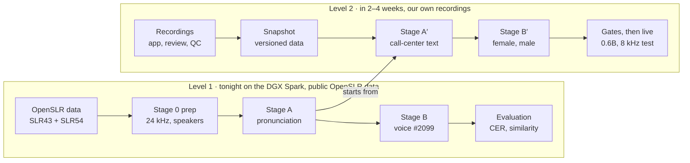

# Nepali TTS for Call Center — Research, Plan and Handover

Oct 12, 2026 · Markdown snapshot of the [live doc](https://claude.ai/code/artifact/6c6e861e-332c-4d77-a31d-dc6311b8ab09); if they differ, the live doc wins.

## Summary and what we need from you

We will fine-tune **Qwen3-TTS-12Hz-1.7B-Base** for Nepali in two levels. Level 1 runs tonight on the DGX Spark using public OpenSLR data and gives us a first female baseline voice. Level 2 adds our own recorded voices (one female, one male) and call-center vocabulary once recordings exist, in about 2–4 weeks.

The headline finding: the Hugging Face "openSLR-Nepali" dataset is 98% speech-recognition data from 515 crowd-sourced speakers, with no male TTS voice in it. So public data can teach the model **Nepali pronunciation**, but our call-center **voices** must come from our own recordings.

**What we need from you, by tomorrow morning:**

- [ ] **Confirm or challenge the research** in the Research, dataset and Level 1 sections. Especially check model choice, the pre-emphasis finding and the two-stage plan.
- [ ] **Write the fine-tune scripts** for the DGX Spark (data prep, Stage A, Stage B, evaluation), as specified in the DGX runbook below. Put them under `training/` on the fork's nepali-tts branch (see Start here).
- [ ] **Run them tonight.** Start with a 15-minute timing test, then launch Stage A and Stage B overnight.
- [ ] **Bring results tomorrow:** loss curves, the evaluation table, and the listening set of audio samples from each checkpoint.

The data collection and Level 2 sections are context for where this goes next; no action needed on them tonight.

## Start here

All code and prompt lists are on the **`nepali-tts` branch of our fork, [sr198/qwen3-TTS-finetune-studio](https://github.com/sr198/qwen3-TTS-finetune-studio/tree/nepali-tts)**. The fork is public, because it is a fork of a public repo. **Never open a pull request against the upstream `bc-dunia` repo.** GitHub defaults a fork's pull requests to upstream, so check the base repository before creating one.

```bash
git clone -b nepali-tts https://github.com/sr198/qwen3-TTS-finetune-studio.git
cd qwen3-TTS-finetune-studio

# Reproduce the dataset findings (downloads 22 MB of metadata, no audio)
python3 research/profile_openslr.py --cache data/openslr_meta

# Regenerate the recording prompt lists (deterministic; matches the committed files)
python3 recording/build_prompts.py --metadata data/openslr_meta/metadata.csv \
  --slr54 data/openslr_meta/utt_spk_text.tsv --out recording/prompts
```

Both scripts use only the Python standard library. `data/` is git-ignored.

| File | What it is |
| --- | --- |
| [`research/profile_openslr.py`](https://github.com/sr198/qwen3-TTS-finetune-studio/blob/nepali-tts/research/profile_openslr.py) | Reproduces every number in the dataset section |
| [`third_party/Qwen3-TTS/finetuning/`](https://github.com/sr198/qwen3-TTS-finetune-studio/tree/nepali-tts/third_party/Qwen3-TTS/finetuning) | Patched official `prepare_data.py`, `dataset.py`, `sft_12hz.py`, the starting point for tonight's scripts |
| [`recording/build_prompts.py`](https://github.com/sr198/qwen3-TTS-finetune-studio/blob/nepali-tts/recording/build_prompts.py) | Builds the prompt lists: call-center prompts plus corpus sentences chosen for syllable coverage |
| [`recording/domain_prompts.py`](https://github.com/sr198/qwen3-TTS-finetune-studio/blob/nepali-tts/recording/domain_prompts.py) | Call-center sentences and number templates (draft, needs native review) |
| [`recording/nepali_numbers.py`](https://github.com/sr198/qwen3-TTS-finetune-studio/blob/nepali-tts/recording/nepali_numbers.py) | Numbers, amounts, digits, Bikram Sambat dates and times as Nepali words |
| [`recording/prompts/`](https://github.com/sr198/qwen3-TTS-finetune-studio/tree/nepali-tts/recording/prompts) | Generated lists: `all_prompts.tsv`, `voice_talent.tsv`, `contributor_01–08.tsv` |
| [`docs/nepali-tts/`](https://github.com/sr198/qwen3-TTS-finetune-studio/tree/nepali-tts/docs/nepali-tts) | Markdown copies of this doc and the recording guide, for readers without access to the live docs |

Put tonight's new code under `training/` on the same branch and push it to the fork.

## At a glance



Stage A is the bridge: tonight it learns Nepali pronunciation from public data, and every Level 2 voice starts from it.

## Research: how Qwen3-TTS works and which model to use

Recommendation: fine-tune **Qwen3-TTS-12Hz-1.7B-Base** first, then retrain the same recipe on **0.6B-Base** if production latency or cost needs it. Benchmark against **Indic Parler-TTS** tomorrow, because it supports Nepali out of the box.

### How Qwen3-TTS works

- **Codec tokenizer** (`Qwen3-TTS-Tokenizer-12Hz`): turns 24 kHz audio into 12.5 frames per second, each frame 16 codes from codebooks of 2,048 entries. It stays **frozen**; we never train it. It is language-agnostic, so it can already encode and decode Nepali speech.
- **Talker LM** (0.6B or 1.7B): reads text tokens and predicts codebook 0 of each frame autoregressively. A small sub-talker predicts codebooks 1–15. **Fine-tuning updates these weights.**
- **Speaker embedding:** a speaker encoder turns a reference clip into one vector, which is inserted at position 6 of the prompt. Speaker identity enters the model only through this vector.
- **Text:** Qwen's tokenizer reads Devanagari fine, but **Nepali is not one of the 10 supported languages** (Chinese, English, Japanese, Korean, German, French, Russian, Portuguese, Spanish, Italian). The model has never learned how Devanagari sounds, so fine-tuning must teach pronunciation, not just voice. That is why we use two stages.

So "a Nepali foundation model" means two separate things. **Language** (pronunciation, the dropped inherent vowel, conjuncts) needs many speakers and hours of data. **Voice** (one person's timbre and style) needs 30 minutes to a few hours from one person. Mixing both in one run tends to give either a good voice with bad pronunciation or a blend of voices.

### Model options

| Model | Size | Nepali | License | Verdict |
| --- | --- | --- | --- | --- |
| Qwen3-TTS-12Hz-1.7B-Base | 1.7B (2B incl. extras) | Not supported; learned by fine-tuning | Apache-2.0 | **Use.** Highest quality ceiling, official fine-tune scripts, streaming with a claimed 97 ms latency |
| Qwen3-TTS-12Hz-0.6B-Base | 0.6B | Not supported | Apache-2.0 | **Later.** Production candidate once the 1.7B recipe works |
| Qwen3-TTS 1.7B CustomVoice / VoiceDesign | 1.7B | Not supported | Apache-2.0 | Skip. Preset or described voices; we create our own |
| Indic Parler-TTS (AI4Bharat) | 0.9B | **Officially supported**, one Nepali voice ("Amrita") | Apache-2.0 | **Benchmark.** Run the same eval sentences through it as a baseline to beat |
| Meta MMS-TTS (Nepali) | small, VITS | Supported, single speaker | Likely CC-BY-NC (to verify) | Reference only; non-commercial licence |

**Please challenge this:** if Indic Parler-TTS beats our Level 1 baseline on intelligibility and native listening tomorrow, we should discuss before investing in Level 2 on Qwen3. Qwen3's advantages are streaming latency, voice cloning and the fine-tuning path; Indic Parler's is that it already speaks Nepali.

## What the OpenSLR Nepali dataset really contains

The Hugging Face dataset [Aananda-giri/openSLR-Nepali](https://huggingface.co/datasets/Aananda-giri/openSLR-Nepali) (118,231 clips, 57.3 h) merges two different OpenSLR corpora and drops their speaker IDs. Run [`research/profile_openslr.py`](../../research/profile_openslr.py) from the fork to reproduce this table from its `metadata.csv`:

| Part | Source | Clips | Hours | Speakers | Notes |
| --- | --- | --- | --- | --- | --- |
| `quality=low` | [SLR54](https://www.openslr.org/54/), a speech-recognition corpus | 116,369 | 55.1 | 515 (recovered) | Crowd-sourced, varied mics, **median clip 1.5 s**, max 18 min per speaker |
| `quality=high`, files `nep_*` | [SLR43](https://www.openslr.org/43/), Google's Nepali TTS corpus | 1,438 | \~1.5 | 18, all female | Clean read speech. Largest: #2099 16.6 min, #0546 15.5 min, #3614 12.8 min |
| `quality=high`, files `Voice*` | Unknown | 424 | 0.65 | Unknown, mixed | Contains **all the male audio: 109 clips, 11 minutes** |

### Problems for TTS, and fixes

1. **No male voice.** 11 minutes from an unknown source is not enough. The male voice must be recorded (see Data collection for Level 2).
2. **Preprocessing suited to speech recognition, not TTS.** The dataset README says a **pre-emphasis filter (coefficient 0.97)**, RMS normalization and resampling to 16 kHz were applied. A TTS model would learn that brighter, thinner sound. Fixes:
   - SLR43: download the **raw release** from OpenSLR (`ne_np_female.zip`, 800 MB, full sample rate, speaker IDs in filenames) instead of using the HF copy.
   - SLR54 (HF copy): undo pre-emphasis with the inverse filter `y[n] = x[n] + 0.97·y[n−1]`. **Not yet verified on actual audio**: compare spectral tilt on a few clips before and after, and against raw SLR54 clips from OpenSLR.
3. **Speaker IDs are recoverable.** OpenSLR's [`utt_spk_text.tsv`](https://www.openslr.org/resources/54/utt_spk_text.tsv) maps every SLR54 utterance ID to a speaker; all 116,369 HF clips matched. SLR43 speaker IDs are in the filename (`nep_<speaker>_<id>`).
4. **Most SLR54 clips are too short for TTS.** After filtering to clips of 2 s or more with SNR of at least 13 dB, about **13.6 h from 445 speakers** remains (17,954 clips). That is useful for pronunciation, not for a voice.
5. **Text is already normalized.** No digits appear in any transcript; numbers are written as words. Our inference text normalizer must produce the same spellings.

All of this data is CC BY-SA 4.0.

## Level 1 fine-tune on OpenSLR

Level 1 has two stages. **Stage A** teaches Nepali pronunciation from many speakers. **Stage B** turns that into one female baseline voice. Its output is a testable model plus a Stage A checkpoint that all Level 2 voices will start from.

### Stage 0: data preparation

1. **Sources:**
   - SLR43 raw: all 18 speakers.
   - SLR54 from the HF copy: clips of 2 s or more with SNR of at least 13 dB, speaker IDs joined from `utt_spk_text.tsv`.
   - Skip `Voice*` for now (unknown source).
2. **Hold out for evaluation:** two small SLR43 speakers (e.g. #6587 and #3997) and 200 sentences, never trained on.
3. **Audio:** de-emphasize SLR54, resample everything to 24 kHz mono, trim leading and trailing silence to about 0.15 s, and normalize loudness to the same level (e.g. −20 dBFS RMS). Drop clips that clip or fail decoding.
4. **Text:** Unicode NFC, collapse whitespace, ensure end punctuation (। or ?). No digits should remain.
5. **Reference audio:** for each speaker, pick one clean 5–8 s clip as `ref_audio`.
6. **JSONL** in the official format `{"audio", "text", "ref_audio"}`, plus a `speaker` field for our own bookkeeping.
7. **Codec tokens:** run the official `prepare_data.py` with `Qwen/Qwen3-TTS-Tokenizer-12Hz` to add `audio_codes`.

### Stage A: Nepali language adaptation (multi-speaker)

- Start from `Qwen/Qwen3-TTS-12Hz-1.7B-Base`.
- Each clip's `ref_audio` is that **speaker's** reference clip, so identity rides the speaker embedding while the shared weights learn pronunciation.
- Weight SLR43 about 2× (repeat its rows), because it is clean read speech close to what we want.
- Starting hyperparameters: learning rate 1e-5 with warmup and cosine decay, effective batch around 32, 2–3 epochs.
- Save Stage A with the **Base** config, not `custom_voice` (see code issues below).

### Stage B: first baseline voice (single speaker)

- Start from Stage A. Speaker: SLR43 **#2099** (16.6 min, 166 clips), with one fixed `ref_audio` for every row.
- Learning rate 2e-6 to 5e-6, 5–10 epochs, save every epoch (the run is tiny).
- **Ablation if time allows:** also run Stage B directly from the Base model. If it sounds as good, Stage A isn't earning its cost.

### Known issues in the vendored `sft_12hz.py`

| Issue | Where | Impact | Fix |
| --- | --- | --- | --- |
| Speaker embedding saved from the first sample of the first batch | `sft_12hz.py:212` | Stage A saves a random speaker into the voice slot | Stage A: save as Base. Stage B: compute the embedding from the chosen reference clip, or average several clips of the speaker |
| No validation loss | training loop | No overfitting signal | Evaluate loss on held-out rows each epoch |
| No warmup or LR schedule | optimizer setup | Unstable start at higher learning rates | Linear warmup plus cosine decay |
| Every checkpoint copies the whole model folder | save block | Several GB per epoch | Keep the best 2–3; watch disk |
| Saved config forced to `custom_voice` with one speaker | save block | Fine for Stage B, wrong for Stage A | Flag to keep the Base config |
| No language token ("nothink" path) | `dataset.py` | Nepali has no language ID; fine | Use automatic language at inference; verify the API call |

### Limitations to expect from the baseline

- The voice comes from 16.6 minutes of a volunteer reading literary and news sentences. Expect a recognizable but imperfect voice, not a call-center style.
- Most training audio started at 16 kHz, so there is no content above 8 kHz. That is inaudible on a phone call but noticeable on headphones.
- SLR54's noise and mic variety may leak into Stage A; the speaker embedding absorbs some of it, not all.
- Numbers, dates and English words are thinly covered; expect mistakes there.
- Qwen officially supports only single-speaker fine-tuning. Our multi-speaker Stage A uses the same code but is untested, so treat it as an experiment.

## Tonight on the DGX Spark: runbook

The Spark has one GB10 Grace Blackwell chip, a 20-core **Arm** CPU and **128 GB of memory shared by CPU and GPU** (273 GB/s). It can hold a full 1.7B fine-tune, but it is much slower than a datacenter GPU, and anything else running eats the same memory. Sizing tonight's run from a measured timing test is the main job.

### Steps

1. **Free the machine.** Stop the other model servers; memory is shared, so they compete with training directly. Confirm with `nvidia-smi` and `free -g`.
2. **Environment.**
   - Use NVIDIA's PyTorch container for Arm (`nvcr.io/nvidia/pytorch`, a recent tag) rather than pip wheels.
   - Inside it: `pip install qwen-tts` plus the repo's `requirements.txt`, and set `HF_TOKEN`.
   - Use PyTorch's built-in attention (`--attn_implementation sdpa`). `flash_attention_2` probably has no Arm/Blackwell wheel; don't spend the evening building it.
   - Sanity check: `python -c "import torch; print(torch.cuda.get_device_name(0))"`.
3. **Precision: keep fp32 weights.** Load the model in fp32 (`--torch_dtype float32`) and train with `--mixed_precision bf16` (autocast). The script's default loads bf16 weights. At learning rates like 2e-6, Adam's per-step updates are below bf16's precision for typical weight sizes, so many updates are silently lost. fp32 weights plus Adam state for 2B parameters is about 32 GB, which fits.
4. **Download data** (about 7 GB):
   - HF dataset: `metadata.csv` and `nepali-dataset.zip` (5.5 GB).
   - SLR43 raw: `https://www.openslr.org/resources/43/ne_np_female.zip`.
   - SLR54 speaker map: `https://www.openslr.org/resources/54/utt_spk_text.tsv`.
   - Allow roughly 60 GB of disk in total, mostly for checkpoints.
5. **Verify the pre-emphasis claim** on about 20 SLR54 clips. Compare spectral tilt with and without the inverse filter, and against SLR43. If the HF audio is not actually pre-emphasized, skip the inverse filter.
6. **Build the data** (Stage 0 under Level 1): JSONL files for Stage A, Stage B and the held-out set, then `prepare_data.py` for codec tokens.
7. **Timing test (15 min).** Run Stage A with `--max_steps 100`. Record seconds per step and peak memory, then size Stage A to **finish by about 05:00**. If a full epoch over 15 h of audio doesn't fit, keep all SLR43 and the highest-SNR SLR54 clips until it does.
8. **Launch overnight** in `tmux`, logging to file:
   - Stage A, then Stage B from Stage A.
   - Then the Stage B ablation from Base.
   - Then the evaluation script (below).
   - Chain them in one driver script so nothing waits on a human.

### Evaluation script

- **Eval text:**
  - The 200 held-out sentences.
  - 30 call-center prompts from `recording/prompts/all_prompts.tsv` (numbers, dates, English words).
  - 20 fixed listening sentences.
- **Systems to compare, same text for each:**
  - Base model cloning from #2099's reference clip (zero-shot).
  - Stage A, cloning from the same reference.
  - Each Stage B epoch, and the Stage B ablation.
  - Indic Parler-TTS.
- **Metrics per system:**
  - **CER**: transcribe with one Nepali speech recognizer and compute character error rate against the input text. First run the recognizer on real held-out recordings to get its error floor.
  - **Speaker similarity** to the reference clip; `finetune_studio/quality.py` has a speaker-cosine helper.
  - **Speaking rate** in characters per second, to catch rushed or dragging speech.
- **Output:**
  - A CSV of metrics.
  - A folder of WAVs per system for the listening set.
  - Loss curves from TensorBoard.

Recognizer choice is open. Whisper large-v3 with `language="ne"` is weak on Nepali. A Nepali fine-tuned Whisper or wav2vec2 model, or MMS-1b-all with its Nepali adapter, is likely better. Pick one and use it for every system.

### Deliverables tomorrow morning

- [ ] Timing-test numbers and the Stage A size actually used
- [ ] Loss curves (train and held-out) for Stage A and Stage B
- [ ] Metrics CSV for every system
- [ ] Listening folder: 20 sentences × each system
- [ ] Notes on anything that broke or behaved oddly, especially the pre-emphasis check

## Data collection for Level 2

We record one female and one male voice talent at 2–4 hours each, plus 5–15 contributors at 20–60 minutes each. The recorder-facing rules are in the [Recording Guide for Voice Contributors](recording-guide.md) ([live version](https://claude.ai/code/artifact/3b0e7c20-5952-43ca-95d2-cfce2432352e)).

### Steps

1. **Hardware request to infra** (per recording station; start with one, two allow parallel sessions):

   | Item | Recommended | Budget | Approx. USD |
   | --- | --- | --- | --- |
   | Dynamic USB mic | Shure MV7+ | Samson Q2U or ATR2100x-USB | 280 / 70–100 |
   | Closed-back wired headphones | ATH-M50x or Sony MDR-7506 | ATH-M20x | 100–150 / 50 |
   | Mic arm or stand | Rode PSA1+ | Generic scissor arm | 100 / 25 |
   | Pop filter or foam windscreen | Any | — | 10–20 |
   | Reflection filter | Portable vocal shield | Moving blankets | 100 / 30 |

   Dynamic, not condenser: it picks up far less room noise in an untreated office. Headphones, not a call-center headset: a boom-mic headset is the wrong capture device for a TTS voice. Prices are rough list prices; check availability in Nepal.
2. **Script review.** `recording/prompts/` holds a first draft:
   - `voice_talent.tsv`: 1,858 prompts, about 2.2 h.
   - `contributor_01–08.tsv`: 300 prompts each.

   Native speakers edit the `text` column into natural agent-style Nepali, mark a status and add notes. Agree one spelling per English loanword (ओटीपी, केवाईसी…). Nothing is recorded until approved.
3. **Consent.** Every recorder signs before their audio is used. Voice talents sign a fuller agreement covering use of a synthetic copy of their voice on customer calls. Legal should review the wording.
4. **Recording app on the DGX** (to build; office network only):
   - **Script review:** edit, approve or reject, add prompts, keep revision history.
   - **Recording:** browser capture of uncompressed audio with browser processing off, live level meter, room-tone file at session start, record, play back, retake.
   - **Instant QC:** clipping, noise floor, SNR, cut-off speech, speaking rate.
   - **Batch QC:** speech-recognizer text match, queued on the GPU.
   - **Data integrity:** each take stores the text shown at record time; editing a prompt later flags its takes for re-recording.
   - **Export:** frozen, versioned dataset snapshots to the training JSONL. Admin-triggered training comes later.
   - **Hosting:** browsers need HTTPS for microphone access, so the DGX needs an internal certificate.
5. **Pilot.** The first voice-talent session (about 90 minutes) gets a full review, including a short test fine-tune, before scheduling the rest.
6. **Collect.** About 8–15 sessions per voice talent over 2–3 weeks; contributors in 1–3 sessions each.

The prompt builder (`recording/build_prompts.py`) picks general sentences to cover every Nepali syllable seen in the corpus. The number-to-words module (`recording/nepali_numbers.py`) is checked against corpus spellings and should also drive the inference text normalizer.

## Level 2 fine-tune: our voices and our domain

Level 2 repeats the Level 1 recipe on our own recordings. First refresh the language model with call-center text, then fine-tune one checkpoint per voice. Keep **one checkpoint per voice**, not per domain, unless evaluation shows a domain regressing.

### Stages

1. **Stage A′: domain-aware language refresh (multi-speaker).**
   - Continue from Stage A with all contributor and voice-talent recordings.
   - Mix in OpenSLR data as replay so general pronunciation is not forgotten.
   - This is where numbers, dates and English loanwords are learned.
2. **Stage B′: one voice per checkpoint.**
   - From Stage A′, fine-tune each talent separately: `ne_female_01`, `ne_male_01`.
   - One fixed reference clip each, learning rate 2e-6 to 5e-6, epochs chosen by held-out loss and listening.
   - About 1 hour of audio is the minimum; 2–4 hours is the target.
3. **Production model.**
   - Retrain the winning recipe on 0.6B-Base and compare latency and quality.
   - Test streaming.
   - Always evaluate **after converting to 8 kHz phone audio**, since that is what callers hear.

### Domains

- One model trained on text from all domains usually beats separate per-domain checkpoints. Domain adaptation for TTS is mostly vocabulary and prosody coverage.
- New domain data: add it to the next dataset snapshot and rerun Stage A′ and B′.
- A full 1.7B checkpoint is several GB. If we later need many voice or domain variants, test LoRA adapters on the talker (PEFT). The official scripts only do full fine-tuning, so this is untested.
- Two voices in one checkpoint needs a script change (one speaker slot per run today). Start with separate checkpoints.

### Text normalizer (required for production)

- At inference, raw text (रु. १,२५,०००, 98XXXXXXXX, २०८१/०७/१५, OTP, KYC) must become spoken Nepali spelled **exactly as in training**.
- Build it on `recording/nepali_numbers.py` plus a loanword spelling list agreed with the script reviewers.
- Normalizer bugs will be more audible to callers than most model differences.

### Gates before a voice goes live

- CER close to the recognizer's floor on real recordings. Set thresholds from the Level 1 results.
- Speaker similarity stable across a long held-out set.
- Native-speaker listening test, including A/B against the previous checkpoint and against Indic Parler-TTS.
- A review of failure cases: numbers, names, English words, very short and very long sentences.

## The repo

Use the repo for its **patched Qwen fine-tuning scripts** and a few helpers; skip its UI and cloud layers for tonight. Our fork, [sr198/qwen3-TTS-finetune-studio](https://github.com/sr198/qwen3-TTS-finetune-studio), is a fork of [bc-dunia/qwen3-TTS-finetune-studio](https://github.com/bc-dunia/qwen3-TTS-finetune-studio). All our work is on the fork's **`nepali-tts`** branch; the fork's `main` matches upstream. To pull upstream fixes, add it as a read-only remote (`git remote add upstream https://github.com/bc-dunia/qwen3-TTS-finetune-studio.git`), and push only to the fork.

| Path | What it is | Use tonight? |
| --- | --- | --- |
| `third_party/Qwen3-TTS/finetuning/` | Vendored official `prepare_data.py`, `dataset.py`, `sft_12hz.py` with fixes: no future codec layers in the input (upstream PR #178, which caused progressively faster speech), speaker encoder kept in checkpoints, 0.6B embedding-size fix | **Yes.** Start from these, not a fresh upstream clone |
| `finetune_studio/audio_prep.py` | Resample to 24 kHz mono, peak normalize | Yes, or reuse its logic |
| `finetune_studio/quality.py` | Signal metrics (SNR, clipping), Whisper transcript comparison, speaker cosine similarity | Yes, for the evaluation script |
| `qwen_finetune_cli.py` | CLI: `validate`, `normalize`, `prepare`, `train`, `infer`, `review-generation` | Optional; handy for `infer` |
| `recording/` | Our prompt builder, call-center prompts, number-to-words module, generated prompt lists | Use `prompts/all_prompts.tsv` for eval text |
| `qwen_finetune_ui.py`, `cloud/`, `scripts/` | Gradio UI, Cloudflare/RunPod deployment, experiments from an earlier Korean voice project | No |

Put tonight's new code under `training/` on the `nepali-tts` branch: data prep, Stage A/B launcher, evaluation, and the overnight driver script. Commit the exact configs used, so tomorrow's results trace back to them.

## Open questions

- Push access: can you push to the fork (sr198/qwen3-TTS-finetune-studio), or should you open pull requests into its `nepali-tts` branch? Either way, never target the upstream bc-dunia repo.
- Is the HF SLR54 audio really pre-emphasized? Tonight's check (runbook step 5) decides.
- Which Nepali speech recognizer gives the lowest error floor on real recordings?
- Does multi-speaker Stage A help or hurt compared with fine-tuning straight from Base? The Stage B ablation answers this.
- Is Meta MMS-TTS Nepali really CC-BY-NC? This only matters if we consider it beyond a reference.
- What is the actual call-center business (bank, telecom, other)? It shapes the next prompt batch.
- Who signs off legally on the voice-talent consent agreement?

## Sources

- [Qwen3-TTS-12Hz-1.7B-Base model card](https://huggingface.co/Qwen/Qwen3-TTS-12Hz-1.7B-Base)
- [Indic Parler-TTS model card](https://huggingface.co/ai4bharat/indic-parler-tts)
- [Aananda-giri/openSLR-Nepali dataset](https://huggingface.co/datasets/Aananda-giri/openSLR-Nepali)
- [OpenSLR 43: Nepali TTS data](https://www.openslr.org/43/)
- [OpenSLR 54: Nepali ASR data](https://www.openslr.org/54/)
- [NVIDIA DGX Spark specifications](https://www.nvidia.com/en-us/products/workstations/dgx-spark/)
- [Recording Guide for Voice Contributors](recording-guide.md) ([live version](https://claude.ai/code/artifact/3b0e7c20-5952-43ca-95d2-cfce2432352e))
